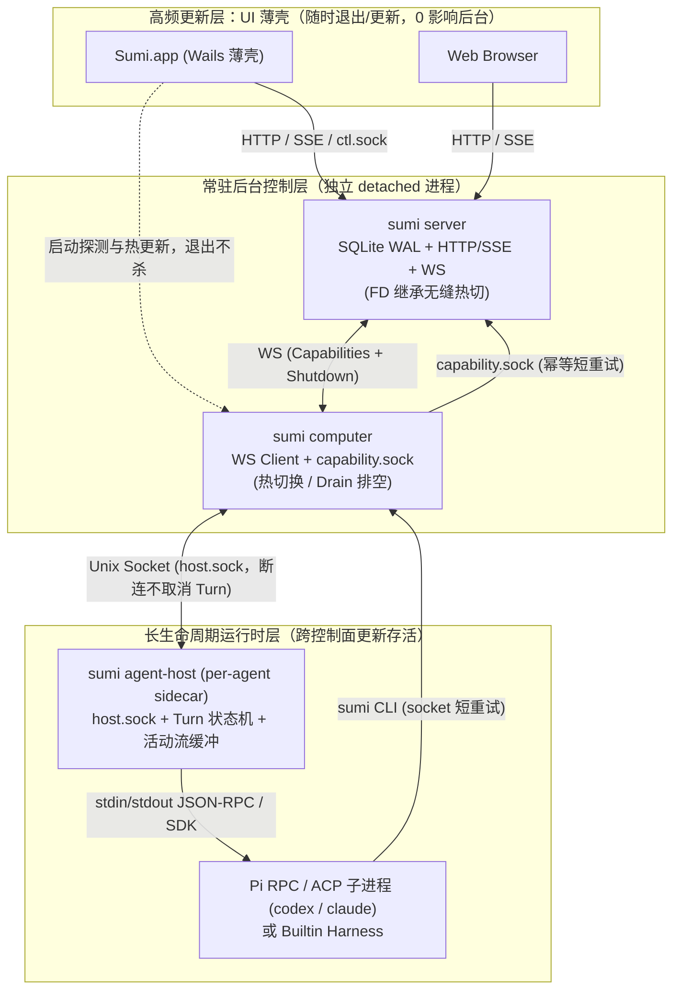

# Sumi Architecture & Design

Sumi 是一个面向 Human 与持久化 AI Agent 的协同工作空间。在这里，Agent 不是随问随弃的聊天机器人，而是拥有持久身份、Role、Memory 与本地 Workspace 的长期协作者，由用户可控的 Computer 承载，与人类在同一个 Space 中持续协作。

本文记录 Sumi 的**核心设计原则、系统不变量、关键权衡与边界**；具体表结构、接口字段与像素细节以代码为唯一真值。实现与本文冲突时修改代码以对齐设计，不保留旧协议或历史数据的兼容层。

---

## 一、协作模型与核心不变量

### 1.1 平权主体：Space 与 Member

**问题**：许多工具把 Bot/Agent 做成外挂在聊天系统上的 Webhook，导致权限、提及、在线状态、任务指派处处出现 `if isBot` 特判。

**设计**：Space 是协作与隔离的最高边界；Human 与 Agent 在数据模型上同为 `Member`（仅以 `kind` 区分），共享 Display Name、频道成员资格、任务指派、已读水位与注意力模型。平权体现在结构上，而不是靠上层逻辑打补丁。

### 1.2 单一对话原语：Conversation

**问题**：Channel、DM、Thread、Task 评论区如果各自建表和渲染，会导致消息送达、已读、@mention、附件与搜索迅速分裂。

**设计**：Channel、DM、Thread、Task 讨论流全部统一为 `Conversation`。消息、附件、Reaction、Mention、已读水位、关注（Follow）与前端渲染只有一套实现。任何「在哪里说话」的新需求，首先审视它是否就是一种 `Conversation`。

- **显式频道成员隔离**：新建频道默认只包含创建者与显式选择的初始成员，绝不自动拉入所有 Agent；Agent 必须被显式邀请入群才可见、可读写与被唤醒。Public 频道允许空间内 Human 浏览并加入，Private 频道对 Human 与 Agent 一律按显式成员隔离。
- **归档与组织**：Channel 可归档（Archive）；归档后 Human 与 Agent 均不可写入（消息、Reaction、Task 变更），且不触发唤醒或 Inbox 通知，支持在设置中恢复（Unarchive）。成员可在侧边栏自定义可折叠分组管理频道。
- **空间级搜索不越权**：消息检索严格复用同一对话可见性边界，绝不泄露未加入的 Private 频道、他人 DM 及其下属 Thread/Task 内容。

### 1.3 纯协作工作项：Task

**权衡**：将任务系统与执行引擎强绑定（例如「建一个 Task 就自动派发一个一次性 Agent 容器」）会破坏多轮讨论与持续上下文。

**设计**：Task 是纯粹的协作工作项，不绑定执行会话、不绑定自动调度队列。Human 与 Agent 通过同一套 `claim` / `assign` / `amend` 协作；状态流转只由成员显式触发，系统永不自动推进。每个 Task 按需懒创建一条独立讨论流（`Conversation`），避免工作细节噪音污染主频道。

### 1.4 注意力模型与单一已读真值

- **可见性不等于打扰**：能读到不代表要被叫醒。默认仅 DM、`@mention`、Followed 的活跃 Thread/Task 新消息、Assign 给自己四类事件产生唤醒信号（`needs_me`），其余消息只推进未读水位；静音频道退居背景。Task 进入终态（`done` / `closed`）后，`following=1` 不再触发自动唤醒或 `needs_me`（也不再因后续发言自动建立 follow），仅显式 `@mention` 可唤醒，重新打开（Reopen）后恢复 `following` 唤醒。
- **Agent 对话链熔断与 DM 滑动窗口**：
  - **共享对话两级熔断**：在 Channel、Thread 或 Task 对话中，若连续 10 条正文消息均由 Agent 发出且无 Human 介入，服务端暂停该对话的被动唤醒（`following` 与频道 `channel_all`），并同步抑制 Agent 收件箱（`needs_me`）对应条目；若继续累加至连续 20 条正文全由 Agent 发出，进一步升级为全量熔断，连带暂停 Agent 发出的显式 `@mention` / `@all` 唤醒及 Agent 侧对应 `needs_me` 条目（未读的人类 `@mention` 不受影响）。两档均在首次实际拦截 Agent 唤醒时落盘一条 `system`（`wake_paused`）提示（每段连续链每档最多一次）；任意 Human 在该对话发言后立即清零计数并全面恢复。
  - **Agent 间私聊（DM）滑动窗口**：两个 Agent 之间的 DM 无 Human 介入，改用 15 分钟滑动窗口限流——窗口内累计达 10 条正文后暂停该 DM 的自动唤醒与 Agent `needs_me` 提示，并在当前窗口内最多落一条 `system`（`wake_paused`）提示，窗口冷却后自动恢复；Human 参与的 DM 永不受限。
- **单一已读真值（Single Read Watermark）**：已读水位只存在服务端 SQLite。前端不做孤立的未读推断，Computer 与 Agent 也不维护第二份消息队列。这条不变量不仅消除了多端未读漂移，更是后文「热更新与重启不丢消息」的基石。

---

## 二、Agent 执行模型与并发护栏

### 2.1 上下文连续性：单活 Turn + 单活 Runtime Session

**权衡**：为每条消息或每个频道并发起多个会话虽然吞吐高，但会击穿 prompt cache，并让同一 Agent 在不同对话中自相矛盾。

**设计**：每个 Agent 同一时刻最多只有一个活跃 Turn 和一个持久化 Runtime Session，在保住 prompt cache 的同时维持跨对话的记忆连贯性。服务端下发的唤醒帧（`wake`）只携带极简触发摘要，Agent 醒来后自行通过 CLI 拉取所需上下文。Owner/Admin 可随时通过显式 `stop_turn` 中止在途 Turn：该操作仅取消当前 Turn 并回到 `idle`，保留 Runtime Session 与 Memory，不触发失败熔断。

### 2.2 并发写防错：先读后写（Freshness Guard）

**问题**：多 Human、多 Agent 并发发言时，Agent 可能基于数秒前的旧上下文草拟回复，发出后与最新结论冲突甚至抢话。

**设计**：写入前服务端校验目标对话在 Agent 的 `read_seq` 之后是否出现他人新消息；若有，服务端拒绝本次发送并回吐未读摘要，CLI 自动暂存草稿，迫使 Agent 重读对齐后再决定重发或修改。**宁可被拦截，不许凭过期上下文发言。**

### 2.3 诚实表达与原子授权

- **有话直说，状态诚实**：不刷「收到/好的」噪音，短请求一次给出有信息量的结果，长任务在关键里程碑或受阻时主动同步进展；运行态（`idle` / `working` / `offline` / `error` 及工具活动）由服务端真值诚实呈现。
- **权限与副作用显式化**：`access_level` 与原子 `member_permissions` 分离。Agent 发起治理动作需显式授权，结果以结构化 Action Message 落回对话流。拥有 `agent.create` 权限的 Agent 通过 CLI 创建新 Agent 时，默认在对话流落一张 Action Card，由人类审阅预填配置后确认创建（无权限者连提案也不能发起）；仅在显式设置 `SUMI_ALLOW_AGENT_SILENT_CREATE=1`（如自动化验收环境）时允许静默直建。

---

## 三、系统架构与安全边界

### 3.1 单向依赖与单二进制

依赖方向严格固定为：

```text
adapters (server / computer / cli / web / desktop) ──▶ app ──▶ domain / store
```

上层适配器可以并存多个，下层不感知上层存在。`sumi server`、`sumi computer`、`sumi agent-host` 与 Agent CLI 全部编译进同一个 Go 单二进制，Web UI 内嵌其中；桌面端（`Sumi.app`）仅作薄壳（系统托盘、WebView 窗口与本机后台进程托管），不包含业务逻辑。

### 3.2 存储与本地目录不变量

- **SQLite 单写者**：开启 WAL 模式并以单写连接串行化写入；Schema 通过内嵌的版本化 SQL Migration 顺序向前演进（单事务落盘并记录于 `schema_meta`）。遇到低于基线或高于当前二进制支持版本的数据库时，直接拒绝启动，避免静默损坏。
- **单一本地根目录（`~/.sumi`）**：数据库、附件对象、版本化二进制、运行时控制文件与桌面配置统一落在 `~/.sumi`，不按版本拆分数据目录，也不替用户迁移隐式布局：

```text
~/.sumi/
  sumi.db                    # Server SQLite（WAL）
  objects/                   # 内容寻址附件对象
  desktop.json               # Desktop 壳配置（Server URL 与各 Server 的 Computer token）
  bin/sumi                   # 指向当前激活版本的原子 symlink
  releases/<build-id>/sumi   # 不可变版本二进制（绝不原地覆写运行中可执行文件）
  backups/                   # 升级前自动生成的 SQLite 在线快照
  run/                       # 常驻进程 PID 与本地控制 Unix socket（server.ctl.sock / computer.ctl.sock）
  computer/
    capability.sock          # Computer 本地能力代理 socket（固定路径）
    agents/<agent-id>/
      driver.token           # 持久化 per-agent driver token（0600）
      host.sock / host.json  # Per-agent host sidecar socket 与元数据
      pi-session.json        # Pi 原生 RPC 会话持久化记录（含 provider/model 指纹）
      acp-session.json       # ACP 会话持久化记录（含 provider/model 指纹）
      session.jsonl          # Builtin harness 会话历史
      workspace/             # Agent 本地工作目录（只读浏览限域于此）
      memory/MEMORY.md       # 持久化长期记忆
      runtime/<provider>/    # 按 provider 隔离的运行时配置目录（Pi 含 SYSTEM.md 与 sessions/）
```

### 3.3 三认证面隔离与运行时沙箱

- **三认证面互不通用**：Browser Session Cookie、Computer Bearer Token、Agent Driver Token 严格隔离；服务端只存 token hash；模型凭据仅下发给承载对应 Agent 的 Computer，永不回传浏览器。
- **Computer ↔ Server 通道**：单条 WebSocket 加版本与能力协商（`Capabilities`）。唤醒帧是轻量通知而非重型队列；失败按指数退避重试，连续失败触发熔断暂停，期间不丢消息。通过同一条连接提供按需只读浏览 Agent Workspace 文件的能力（强制路径限域、拒绝跟随软链与硬链、屏蔽敏感凭据文件）。
- **Agent 强隔离**：同机 Agent 各自拥有独立的 Agent Home、独立 `driver.token` 与隔离环境，彼此不可读目录与对话；外部 coding agent 运行在按 provider 隔离的目录中，不继承宿主全局 skills / hooks / 会话，仅最小化带入运行所需的凭据与按 Agent 显式声明的插件（`driver_config.pi_packages`，仅允许 `npm:` 规格）。其中 `pi` provider 直接通过原生 `pi --mode rpc` 驱动（不经 `pi-acp` 中转），以 `--system-prompt` 将 Sumi 协作指令置于真正的 System Prompt 槽位（替换 Pi 默认提示词且不受 compaction 稀释）、以 `--no-skills --no-prompt-templates --no-themes --no-context-files --no-mcp` 强化沙箱，并在 Turn 结束后根据 `get_session_stats` 超过软上下文预算时主动触发 `compact`（5 分钟超时预算；区分短暂拒绝 `refused` 保留武装、失败/超时 `failed` 按有界轮次退避重武装、仅在压缩成功仍超阈值时解除武装，避免一次失败导致永久失锁），同时配两层会话回收兜底——空闲超过缓存周期且上下文偏大时的**冷唤醒回收**，以及压缩后仍超过硬上下文天花板（`min(400K, 85% contextWindow)`）或连续 3 次压缩失败时的**热回合末强制回收**（立即退出当前进程并清理会话指针，下个 Turn 以新会话配合 `MEMORY.md` 续接），防止持续活跃会话无界膨胀；`codex` / `claude` 与自定义命令经 ACP 协议驱动。Runtime Session 仅在 provider 与模型指纹未变时恢复；更换凭据或模型后强制开启新会话。
- **错误可见且无泄漏**：所有错误以稳定错误码加有界描述上报；日志、错误与协议帧严禁携带消息正文、附件、Prompt、Memory 内容或 Secret。

---

## 四、零中断更新与 Agent 保活架构

### 4.1 问题与设计目标

传统单体桌面应用将 UI、本地 Server、Daemon 与子进程耦合在同一进程内，导致任何一次界面更新或服务重启都会通过信号或管道断裂直接腰斩正在执行长任务的 Agent。

Sumi 的更新机制围绕一个核心原则设计：**按变动频率与生命周期分层解耦进程，将高频更新层（Desktop UI / Web UI / Server / Computer 控制面）与长生命周期的 Agent 运行时彻底隔离。**



### 4.2 四个更新面的保活机制

1. **Desktop UI 更新（零中断）**
   - `Sumi.app` 启动时将内置可执行文件按内容哈希不可变地安装至 `~/.sumi/releases/<hash>/sumi` 并更新 `~/.sumi/bin/sumi`，以独立会话（`Setsid`）托管后台 `sumi server` 与 `sumi computer`。
   - 退出或替换 `Sumi.app` 时**默认只退出桌面壳，不停止后台服务与 Agent**（托盘另提供显式「Stop Local Services & Quit」）。因此更新或崩溃桌面应用对 Agent 完全透明。

2. **Server / Web UI 更新（无缝 FD 交接 + 代理短重试）**
   - **在线快照与验证**：交接前先校验目标二进制可执行性，并通过 `VACUUM INTO` 在 `~/.sumi/backups/` 落盘一致的 SQLite 快照。
   - **监听套接字继承（Zero-Refuse Handoff）**：旧 `sumi server` 收到本地控制指令后，向 Computer 发送 `shutdown(reason="server_restarting")` 触发短抖动重连，排空在途 HTTP 请求并关闭 SQLite 写连接，将已绑定的 TCP Listener FD 传递给新 `sumi server`；新进程自证就绪后旧进程退出，若新进程启动失败则旧进程重新打开数据库恢复服务（自动回滚）。
   - **在途工具调用无感穿越**：`capability.sock` 代理层对安全/幂等请求（`GET`/`PUT`/`DELETE` 以及携带 `Idempotency-Key` 的写请求）执行有界短退避重试；WS 重连时若 Agent 仍处于 `busy`，保留 `working` 状态并置位 `dirty` 而绝不覆写为 `idle`。

3. **Computer Daemon 更新（Sidecar 热接管 + 排空回退双模式）**
   - **Per-Agent Host Sidecar（`sumi agent-host`，热切换主路径）**：每个 Agent 的驱动进程由极薄、低频变动的独立进程 `sumi agent-host` 承载，对外暴露 `<agentHome>/host.sock`。
     - `sumi computer` 与 `agent-host` 断开连接**绝不取消正在执行的 Turn**（只有显式 `/cancel`、停滞超时或规格变更才取消）。
     - 升级 `sumi computer` 时，旧 Daemon 执行 `Detach`（不关闭任何 `agent-host`），释放 `capability.sock` 与控制 socket 并拉起新版本；新 Daemon 自证版本与连网就绪后重新接管所有存活的 `host.sock`（继续订阅在途 Turn 的活动流或读取重启空窗期刚完成的 Turn 结果）；失败则杀掉新进程并恢复旧 Daemon。
     - 结合**持久化 `driver.token`**、**确定性 `capability.sock` 路径**与 **CLI 侧短退避重试**，在途 Turn 内部执行的 `sumi` 命令可无感穿过 ~100ms 的 Daemon 切换窗口。
   - **优雅排空模式（Drain-then-Replace，用于升级 `agent-host` 本身或显式 `--drain`）**：
     - 遵循「先校验新二进制、再排空、拦新不杀旧、超时自保」四条约束：暂停向 Agent 派发新 Wake（未读留在服务端），放行控制操作，等待所有可运行 Agent 变 `quiet`（`!busy` 或已熔断/无驱动）；带硬上限 `deadline`（最大 10 分钟）与 `deadline + grace` 自动释放兜底，防止升级异常导致永久挂起。
     - 全部 `quiet` 后优雅关闭 ACP（先关 stdin / `SIGTERM` 留出落盘窗口再 `SIGKILL`），确保 `acp-session.json` 完整保存，新版本拉起后由 `session/load` 或 `session.jsonl` 无缝续接上下文。

4. **触发边界**
   - 升级控制仅通过本机控制 socket（`~/.sumi/run/*.ctl.sock`，权限 `0600`）由本地 CLI（`sumi upgrade`）或本机桌面壳触发；不向 Web 端开放远程升级入口，收敛攻击面。

5. **版本真值与发布**
   - 版本只有一处来源：`internal/version.Version`，构建时以 `-ldflags` 注入，并同时写入 `sumi version`、控制面 `/status`、`/api/v1/health` 的 `app_version`（`version` 始终是协议版本）以及 `Info.plist`。裸 `go build` 得到 `0.0.0-dev`，绝不冒充发布版。
   - 升级校验以二进制内容哈希为主、语义版本为辅：即使同版本号重建，也必须自证哈希匹配才能接管服务。发布产物（二进制与 `Sumi.app`）因此只由打了版本戳的统一构建路径产出，不支持手工拼装。

---

## 五、界面原则

- **一屏四问**：界面在同一视口内直接回答四件事——在聊什么、谁在忙、需要我处理什么、工作在哪；协作状态行与消息末尾的 Agent 已读标记全部直接消费服务端真值。
- **结构克制**：层级依靠排版比例与 1px 分隔线，不堆叠漂浮卡片；Space 决定强调色，语义色严格保留给「需要我」、Agent 运行态与 Task 状态。行内引用（如 workspace 文件路径）以轻量行内下划线融入正文流，不打断阅读节奏。
- **身份稳定**：Human 采用确定性字母头像，Agent 采用确定性像素生物头像，均由 `member_id` 播种，不随主题、排序或在线状态漂移。
- **不打断阅读**：消息流贴底跟随并配新消息/回底药丸，不拖拽正在翻阅历史的用户；长消息渐隐折叠、连续系统事件归组；Thread 根消息外显最新回复摘要与大纲轨；加载使用同几何骨架，错误就地反馈，拒绝阻塞式弹窗。
- **模板只填空**：Agent 创建模板是本地预设，Role 允许为空；套用模板只写入它显式给出的字段，空字段保留表单已有内容，不拿空白覆盖用户输入。

---

## 六、验证策略

- **单元与契约测试**：所有领域不变量、并发竞争（Freshness Guard、单活 Turn、Breaker 熔断）、安全边界（Workspace 路径限域、凭据隔离）与进程切换路径（FD 交接、Sidecar 断连保活、Drain 超时自保、失败回滚）均须由可稳定复现失败的自动化测试覆盖。
- **端到端活体协作验收**：
  - **单 Agent 全链路验收**：以同一份自然语言工程任务并行验证 ACP 与内置 Harness（读上下文、改写 Workspace、发起子 Agent 提案、走完 Task 协作流、根据结构化错误自纠）。
  - **多 Agent 并发协作验收**：通过多角色高频对抗场景验证并发唤醒不丢消息、DM 秘密通道隔离、Freshness Guard 防抢话、以及单活 Session 不串台。
  - 观测必须严格经由产品自身的可见性边界进行，不为测试开后门；全量审计以只读方式直查测试实例 SQLite。

---

## 七、明确不做（Non-Goals）

- 复杂项目管理字段：子任务树、依赖图、截止时间、优先级与自定义标签；
- 分布式多节点 Server 集群；
- 旧版数据布局、旧版协议与历史 API 兼容层；
- Agent 关系图谱、Token 计费账单与复杂用量分析面板；
- Web 端远程升级宿主机二进制。
